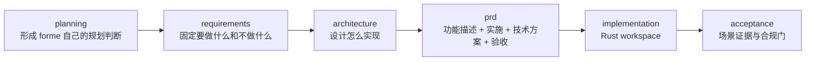

# forme 文档总入口

本文档是 `docs/` 的总入口。全局文档路线、目录职责和跨目录关系以本文档与 `documentation-map.md` 为准；各子目录 `README.md` 只解释本目录内部的文档。

## 当前文档路线

forme 当前文档按“规划判断 -> 需求固定 -> 架构方案 -> 实施型 PRD”推进：

其中 `architecture/canonical-contract.md` 固定跨文档唯一口径，`architecture/02-proactive-cognitive-kernel.md` 固化主动认知内核的设计基准，正式 Rust 实现架构从 `architecture/03-foundation-architecture.md` 开始。早期规划（`planning/01-14`）与早期架构基线（`architecture/00-01`）已移入 `archive/`，只用于了解设计演进。

## 当前里程碑

**本地 main 的工程状态：M0–M5 与 V1 核心大脑 A–D 已实现、通过有界技术 Final 并合入。** 七项默认大脑补闭随 `a1fe0df` 快进合入；许可证调整后的当前回执与重验结果统一见 `acceptance/core-brain-closure-acceptance-report.md`。技术验收、owner 日常使用验收、远端发布分别记录；本地合入不代表已发布安装包，也不证明长期“越用越好”。下面按时间顺序保留各阶段结果。

M0 已完成：18 个 crate、164 个 Rust 测试与 8 个合规 fixture 全绿，`prd/01` §7 的 S1-S22 全部通过，真实配置模型已沿 `Gateway -> Harness -> Loop` 产生完整 13 事件审计链，原创合规门的 upstream/license/copy 三项均为 PASS。逐场景证据见 `acceptance/m0-acceptance-report.md`，固定回归入口为 `tools/verify-m0.ps1`。

M1-A 已完成控制面与评价面；M1-B 已完成后台与主动工作流；M1-C 已完成 automatic compaction、scoped memory review、skill 按需加载、MCP schema 延迟加载/execution recheck 与 plugin lifecycle。当前 18 crates、203 个 Rust 测试与 9 个合规 fixture 全绿，S1-S37 与合规门均 PASS。2026-07-15，真实配置模型完成 repository-owned golden task，18 条 trace refs 与权威事件流一一对应，最终报告见 `acceptance/m1-acceptance-report.md`，typed report 与 portable trace manifest 位于 `acceptance/`。**M1 已完成。**

M2 已沿 `requirements/07-08 -> architecture/05 -> prd/19 -> acceptance` 完整闭合。A 波 Browser/Computer/PTY，B 波 connector/真实沟通，C 波 ResourceGraph/长期目标/能力成长/managed policy/hot-cold + 单 peer CAS sync 均在 owner review 后依次实现。当前 18 crates、252 个非忽略 Rust 测试、S1-S52、真实 Chrome/API/communication 路径、typed artifacts、strict clippy 与合规门全绿；EventKind 保持 86。最终报告见 `acceptance/m2-acceptance-report.md`。**M2 已完成。**

M3 已沿 `requirements/09-10 -> canonical §25 -> architecture/06 -> prd/20 -> acceptance` 完整闭合，并封板。A 波控制面、B 波 domain strategy/long-horizon、C 波 StrategyMemory/AgentSelf/Partnership/Trust/Proactivity/Communication 均在 owner review 后依次实现；18 crates、89 EventKinds、309 个非忽略 Rust 测试、2 个单独实跑的真实 Chrome/Edge golden、19 个 Python 合规/发布 gate fixture、S1-S69、strict clippy 与 clean-tree release audit 全绿。最终 receipt 为 `sha256:fc88e2184e29da666c5fc6373ee08d9829ae127899b901ddbd413364e5ba2c3e`，报告见 `acceptance/m3-acceptance-report.md`。**M3 已完成。**

M4 已沿 `requirements/11-12 -> canonical §26 -> architecture/07 -> prd/21 -> acceptance` 完成实现与 owner 完整验收，并封板。A 波 peer trust/mTLS RemoteExecutor，B 波只读复制/跨设备 owner control，C 波 placement/checkpoint/handoff/scheduler/三进程 golden 已接入同一权威 Harness/EventStore；18 crates、93 EventKinds、350 个非忽略 Rust 测试 + 3 个显式实跑 golden、21 个 Python gate、S1-S84、strict clippy、typed artifacts 与 clean-tree release audit 全绿。首次 owner 验收暴露的 Browser click 完成时序阻断已修复。**M4 已完成。**

M5 已沿 `requirements/13-14 -> canonical §27 -> architecture/08 -> prd/22 -> acceptance` 完整闭合。A/B/C 分别完成 publisher/admission、plan-bound lifecycle/既有 registry、M4-bound remote distribution/release；18 crates、97 EventKinds、379 个非忽略 Rust tests + 4 个显式真实 golden、29 个 Python gate、S1-S99、deterministic typed artifacts、strict Clippy 与 clean-tree release audit 全绿。最终报告见 `acceptance/m5-acceptance-report.md`；工程结果已合入 main。

V1 核心大脑运行闭合已完成 docs-first 冻结：`requirements/15-16 -> canonical §28 -> architecture/09 -> prd/23`。它不是 M6，而是把 M0-M5 的能力装进同一个默认、持久、可恢复的大脑运行时。最终门为 S1-S99 + C1-C24、前 97 exact prefix 后追加 2 个 R 事件、18-crate 图、真实 golden 与 release audit。A/B/C 历史报告保留；D 多模型、看板、备份恢复、加密/迁移/真实删除、原生工具消息续接修复与六任务 runner 依据见 `acceptance/core-brain-d-acceptance-report.md`。当前源码、真实试验、分波清单、Final 与 main 状态只在 `acceptance/core-brain-closure-acceptance-report.md` 汇总，四波封闭证据入口为 `acceptance/core-brain-closure-artifacts/manifest.json`。受控测试或不可验证工件不能替代真实任务与发布门。

## 常驻服务与 Web 工作台（分阶段实施）

产品化方案已形成 `requirements/17–18 -> canonical §29 -> architecture/10 -> prd/24–26`：原生整体安装、OS 系统服务、唯一大脑、账号初始化、本地/LAN Web 与五个工作面。它不是 M6；宿主/worker 基础与独立认证基础已分阶段实施，安装包、原生隔离、完整账号接入与新 UI 尚未完成。分支与证据见 `acceptance/installed-product-implementation-progress.md`、`acceptance/installed-product-25-identity-foundation.md`。

从 [产品架构](architecture/10-installed-product-and-web-workbench-architecture.md) 看全貌；实施按 [安装与服务](prd/24-installer-and-service-lifecycle.md) → [初始化与 Web 接入](prd/25-bootstrap-auth-and-web-access.md) → [工作台](prd/26-web-workbench.md)，使用独立 IP01–IP24 验收。DeepSeek 仅限 [前端许可复用边界](compliance/frontend-reuse-policy.md)，不引入其核心或插件系统。

## 目录职责

| 目录 | 作用 | 当前状态 |
|---|---|---|
| `planning/` | 仍在直接使用的规划设计。 | 当前仅 `15` 多 Agent 编排。 |
| `requirements/` | 固定 forme 要做什么、不做什么、面向谁、优先级和验收方向。 | M0-M5/V1 已落实；`17`–`18` 新定产品化 P01–P16/IP01–IP24，待实施。 |
| `architecture/` | 设计如何实现需求，包括 Rust 模块、协议、数据流、状态机、存储、权限和扩展边界。 | `03`–`09` 对应实现已合入本地 main；`10` 已开始宿主/worker 基础实施，安装/服务/Web 整体仍保持 18-crate/single authority。 |
| `prd/` | 形成可执行的实施型 PRD：功能描述、实施步骤、关键技术约束、测试和验收标准。 | `01`–`23` 对应 M0-M5 与 A–D 已合入；`24`/`25` 的宿主、worker 和认证基础分阶段实施中，24.3/25 余项/26 与原生产品验收未完成，历史 S/C 门继续回归。 |
| `acceptance/` | 保存验收报告、逐场景证据和最终门结果。 | M0-M5、V1 A–D/真实 C24/Final 有通过证据；当前源码、许可证重验和 main 状态统一见 closure 报告，历史失败与 Unavailable 记录保留。 |
| `compliance/` | 直接依赖的来源、许可证与复制风险清单。 | 随依赖变化维护；frontend-reuse-policy 固定限定前端例外，当前未导入源码。 |
| `runbooks/` | 正式入口和离线 owner 操作手册。 | `v1-core-brain-data-and-evidence.md` 说明模型配置、备份/恢复、真实删除、旧明文迁移与 C24 证据运行。 |
| `archive/` | 早期规划 `planning/01-14` 与早期架构基线 `architecture/00-01`。 | 已归档，不再更新，不作为现行口径。 |

## 跨目录规则

- `planning/` 可以提出候选能力和阶段判断，但不能把候选能力直接变成必做项。
- `requirements/` 是后续架构和 PRD 的约束来源；如果架构想新增能力，需要先回到 requirements 固定边界。
- `architecture/` 负责实现设计，不重新定义产品愿景和范围。
- `prd/` 不能发明新需求，只能把已确认的 requirements 和 architecture 拆成可执行任务。
- 所有设计与实现必须遵守 `architecture/canonical-contract.md` §12、`prd/17-originality-compliance.md` 和 `requirements/03-foundation-scope-decisions.md` 的原创性与合规边界。只有在实现引入依赖、代码复用或协议兼容时，才记录具体来源。
- 唯一已批准的前端源码例外按 canonical §29.8 与 `compliance/frontend-reuse-policy.md` 逐文件审查；不扩大到内核/插件/服务端/fixture，不引用 research/upstreams。
- 进入正式架构前，跨文档唯一口径以 `architecture/canonical-contract.md` 为准，尤其是主动等级、稳定性、失败分类、对象 owner、并发、撤销、schema、身份、对外动作、策略进化、联邦运行时和开源 CI 边界。

更细的文档关系见 `documentation-map.md`。
