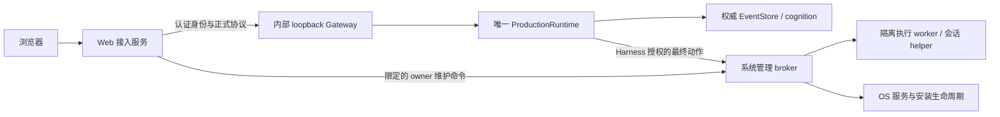

# 常驻服务与 Web 工作台架构

## 0. 定位与状态

本方案实现 [requirements/17 的 P01–P16](../requirements/17-installed-product-scope-decisions.md)，由 [requirements/18 的 IP01–IP24](../requirements/18-installed-product-verification-strategy.md) 验证。口径服从 [canonical](canonical-contract.md) §1–29，特别是 §28 的唯一 ProductionRuntime、99 EventKinds、数据保护和恢复契约。

**这是已确认的产品化设计；宿主底板与 worker admission 基础已开始实施，但原生平台验收、安装包、账号和 Web 工作台仍未完成。** 它不改写 M0–M5/V1 的历史验收，不增加内核、crate 或内部依赖边。实施拆为 [prd/24](../prd/24-installer-and-service-lifecycle.md)、[prd/25](../prd/25-bootstrap-auth-and-web-access.md)、[prd/26](../prd/26-web-workbench.md)。当前代码证据见 `acceptance/installed-product-implementation-progress.md`。

当前 `forme-gatewayd` 从环境构建完整 ProductionRuntime 后才绑定 loopback listener，并提供已有本地静态 UI；它还不是原生系统服务/账号系统。本方案把可离线初始化的 Web 接入独立出来，保留内部 Gateway 的 loopback 限制。M1 的“无桌面壳、无第二 Node 服务”仍成立，新增边界为 Rust Web 接入进程，不是 Node 或另一套 Agent 服务端。

## 1. 运行单元与归属

图中的管理命令和 Agent 动作是**不同协议、凭据与授权域**，不能互相转换。broker 不调模型、不生成任务、不订阅认知并自行行动。

| 单元/计划二进制 | 放置位置 | 身份与权限 | 唯一职责 |
|---|---|---|---|
| Web 接入 `forme-webd` | 现有 `gateway` crate 的新 bin/模块 | 独立受限 Web 服务身份；只能读静态 UI、自有认证库和有限 IPC credential。 | bootstrap、登录、外部 HTTP/TLS、转发、维护页面。不能读 brain DB/provider keys。 |
| 核心 `forme-gatewayd` | 现有 `gateway` crate | 独立 brain 服务身份；拥有 brain store/key resolver，内部 listener 仅 loopback。 | 唯一 ProductionRuntime、scheduler、认知、治理与事实源。 |
| 系统管理 `forme-hostd` | 现有 `execution` crate 的新 bin/模块 | 安装时配置系统管理权限，接口与可操作对象严格列举。 | 服务控制、受保护配置/版本切换、typed 特权动作、隔离 worker 生命周期；无大脑。 |
| 操作工具 `forme-hostctl` | 现有 `cli` crate 的子命令入口 | 本机 operator 身份，经 OS ACL/管理授权调用 broker。 | headless bootstrap、状态、离线修复和恢复；不另起大脑。 |
| `forme-executord` / 会话 helper | 现有 `execution` crate 的 bin/模块 | 工具专用低权限账户或指定登录会话身份。 | 执行 exact plan/job、限时返回结果；无认知和 stable write。 |

这些名称是本次新增产品入口，不能据此改名或复制上游工程。共享 wire DTO 仅放现有 `protocol`；OS 适配与 worker 在 `execution`，不让 gateway 新增直依赖 execution/config/store。gateway 通过现有 Harness 外观与 protocol client 接口集成，cli 仍只依赖 gateway/protocol。所有平台 binding 采用可审计的安全封装，项目 crate 保持 `forbid(unsafe_code)`；无法在现图落地时先修改设计，不能隐增依赖边。

OS 服务管理器分别监管三个长期服务。broker 可以要求 OS 开始/停止 core，但不另设抢跑的崩溃重启 loop；每个长期进程只有一个 supervisor。短期 worker 由 broker 管理截止、取消与清理，不做自动副作用重试。Web 崩溃不影响核心；核心崩溃不影响登录与诊断。

## 2. 安装、账户与路径

| 平台 | 服务/账户 | 程序与配置 | 持久数据、运行态 |
|---|---|---|---|
| Windows | SCM；Web/Brain 独立虚拟服务账户与 service SID；broker 为受限接口的 LocalSystem 服务，执行使用另一个低权限身份。 | `%ProgramFiles%\ForMe\releases\<release_id>`；`%ProgramData%\ForMe\config`。 | `%ProgramData%\ForMe\{brain,web-auth,host-state,keys,logs,backups,workspaces}`；命名管道按服务 SID 设 DACL。 |
| macOS | 系统 LaunchDaemon；`_formeweb`、`_formebrain`、执行账户分离；broker root。 | `/Library/ForMe/releases/<release_id>`；`/Library/Application Support/ForMe/config`。 | `/Library/Application Support/ForMe/{brain,web-auth,host-state,keys,logs,backups,workspaces}`；受保护本地 socket 目录。 |
| Linux | 系统 systemd；`forme-web`、`forme-brain`、`forme-exec`；broker root。 | `/opt/forme/releases/<release_id>`；`/etc/forme`。 | `/var/lib/forme/{brain,web-auth,host-state,keys,backups,workspaces}`；`/var/log/forme`；`/run/forme` sockets。 |

路径由安装 manifest 固定并规范化为绝对路径，不能依赖调用 shell 的 cwd。分区磁盘、外置 workspace 可由 owner 选择；必须防 symlink/reparse-point 跳转，验证身份/ACL/容量和最终真实路径后才接管。

程序版本由管理员拥有，Web/brain/tool 不能写；Web 认证库不允许工具/brain 读取；brain DB 和 keys 不允许 Web/worker 读取。不能把多个服务放在同一个普通用户下，再把不同进程误称为隔离。默认 workspace 对工具可写，管理目录、旧备份和其他项目不可写。

Windows `.exe` 采用 Inno Setup 构建并签名；macOS `.pkg` 使用签名和公证；Linux `.deb/.rpm` 使用可信软件包签名。统一下载入口选择平台包并先验证来源，不执行未验证远程脚本。原生支持目标与证据按 requirements/17 §3、18 §3，不扩大到所有 Linux。

安装程序只负责管理员确认、解包、目录权限、服务注册/启动与打开调用者浏览器。程序与静态 UI 同一 release manifest；没有全局 Node runtime。可选工具 runtime 使用受校验的 managed dependency manifest，许可/版本/下载来源/卸载归属明确，不改变宿主已有 Python/Node。

## 3. 产品状态与初始化事务

以下枚举是**产品状态**，不是 Run/Terminal/PendingKind 的替代。`HostStatus` 同时提供 product state、core health、config revision、release id、blocking issue refs 与可用操作。

| `ProductState` | 含义 | 可用入口 |
|---|---|---|
| `Unclaimed` | 尚未完成本机安装认领。 | 最小公开状态、认领；不暴露路径/owner。 |
| `ConfigurationRequired` | 已认领，但必需配置/key/doctor 未完成。 | 已认证配置/检查/历史数据接管。 |
| `Starting` | 正在按固定配置启动唯一 core。 | 状态、诊断、明确取消启动。 |
| `Ready` | ProductionRuntime ready 且 reader/writer/身份检查通过。 | 全工作台。 |
| `Degraded` | 核心或部分能力受损，可定位限制。 | 依实际能力开放；禁止静默替代脑/模型。 |
| `Maintenance` | 正在排空、升级、恢复或离线迁移。 | 登录、进度、诊断；正常 mutation 关闭。 |
| `RecoveryRequired` | 数据/密钥/版本/未知副作用需要 owner 裁决。 | 有限修复与恢复；不自动重跑动作。 |
| `Stopped` | owner 明确停止核心。 | 登录、维护、受控启动。 |

broker 管理安装/config/lifecycle 的版本化事实；core health 从其就绪/心跳和 OS 状态派生。Web 不得仅凭端口可连接设置 Ready；必须验证 owner/store binding、composition、doctor 和预期 config revision。

初始化流程：安装创建 `InstallId` 与 256-bit 随机一次性证明（30 分钟、可经本机管理权限轮换）→ 只在受保护文件/本机终端交给安装者 → 浏览器 POST 证明并原子预留 claim → 获得 15 分钟的有限 setup session → 检查现有脑/可验证恢复候选或选择新脑 → 按已验证数据绑定 stable OwnerId 并创建 password hash → 提交 claim/消耗 setup session → 生成 owner 会话 → 保存/校验模型与 workspace 配置 → 启动 core → 核对 ready manifest。

setup session 只允许检查本机已识别的安装数据、准备受限备份候选和完成认领，没有普通 task/维护权限。claim 完成前不写新 brain；已有数据/恢复候选的 OwnerId 由其完整性和解密验证得出，不能由浏览器填写。已认领 installation 不允许用恢复另一 owner 的备份暗换身份；需独立安装/明确重新接管流程，不提供 SetOwner API。

证明不进 URL/query/日志/页面 HTML/剪贴板自动同步。匿名页面不能获取它。所有认领 CAS 到同一 InstallId，事务中断可按 claim operation 恢复，不能出现两个 owner 或“已认领却永远无法登录”。无桌面主机使用 `hostctl` 从本地/SSH 管理终端取证明，并通过 SSH tunnel 访问 loopback 初始化；未认领前不默认开启 LAN。

发现历史数据时先只读检查 owner/store/schema/key resolver/明文保护状态与独占锁；可验证备份后才显式选择接管/迁移。不匹配、无法解密、明文未迁移或库正被使用时停在可修复状态。不能为绕过错误新建另一个空 store 并宣称迁移成功。

## 4. 三种持久状态的界限

| 状态域 | 写者与恢复方式 | 不允许包含/完成的事 |
|---|---|---|
| brain facts | 既有 forme-store 唯一 writer，EventKind/stream_seq + projection/replay。 | Web、broker、认证库不写脑表，不创造新认知事实源。 |
| 产品管理 facts | broker 的 append 管理 journal + CAS config/release manifest；`product_seq` 单调。 | 不记录隐藏 CoT/明文秘密；不冒充 EventKind 或单独推进 run。 |
| Web 认证/session | Web 的独立受保护认证库单写者，transaction/credential revision/revocation epoch。 | 不存模型 key/brain memory，不通过认证库修改 policy。 |

管理记录统一 `schema_version, operation_id, product_seq, expected_revision, actor_class, kind, safe_refs, outcome, timestamp`。这些是安装/登录/生命周期的操作记录，**不扩充 99 个大脑 EventKind**。只存 hash/ref 的敏感变更使用受保护配置作为恢复输入，journal 不保存 password hash、token 或 SecretRef identifier。完整核对用安全 operation/run refs；大脑的事实交换仍只走既有事件。

config 的 staged、validated、active revision 和 core 的 acknowledged revision 分离；active 切换必须有 journal intent/commit，可在断电后判断下一动作。产品管理记录不能代替 core 已接受配置/已完成动作的证据。

## 5. 认证、配置与内部传输

### 5.1 Owner 登录

单 owner 账号使用 Argon2id（初始最低 64 MiB、3 iterations、parallelism 1；参数随 hash 保存，可升级）。口令接受 12–128 个字符且 UTF-8 不超过 1024 bytes，不静默 trim/改变口令；统一错误反馈。限制密码计算并发和登录速率，不以永久锁住唯一 owner 作为防护。

登录成功生成 256-bit 随机 opaque session；服务端只存摘要。默认 idle TTL 30 分钟、absolute TTL 12 小时，可调整；注销/改密码/恢复/全会话撤销使对应 epoch 失效。Cookie host-only、HttpOnly、SameSite=Strict，HTTPS 时 Secure；仅严格 loopback 的本地 HTTP 开发/安装模式允许无 Secure 的独立 cookie 名，不可沿用到 LAN。

改网络、改口令、导出/恢复数据、升级/卸载等高影响操作要求 5 分钟内重新认证，并将凭据绑定具体 operation digest；不授予一个可被任意复用的“管理员模式”。OS 管理员可本机恢复登录，必须记录维护事实、撤销旧会话，保留 OwnerId 和数据 keys；它不是远程匿名重置接口。

### 5.2 配置来源

已安装服务默认从 broker 管理的版本化 typed service config 加载。普通字段与 SecretUpdate 分离；密钥写入 resolver 后只返回 `configured=true` 和安全状态。有效来源、revision、是否待 restart 必须可见；敏感 endpoint/path 只在已认证设置界面按必要范围展示，不进入公共 health/trace。

服务模式不继承交互 shell 环境。开发命令仍兼容 `FORME_*`；显式 environment override 模式必须在有效配置中显示每项来源，不能出现网页显示“已生效”而旧 env 实际生效。禁止运行时修改全局 process env 假装 typed config 热更新。

启动/模型/工具集/网络等变更先 validate，生成影响报告，再以 expected_revision 提交；需要重启则受控排空。进行中的 run 保持原快照，不热换 provider/toolset/policy。运行前实际绑定 provider 和 SessionBound/composition 的行为仍服从 canonical §28。

### 5.3 Web → core

浏览器只持 Web session + CSRF nonce，不持 Gateway bearer、provider key、master key 或 helper credential。Web 在严格授权的本机 IPC/loopback 通道转发请求；core 认证 Web 服务身份，并验证服务端生成的短时登录会话 assertion，绑定不可由 payload/header 伪造的 `AuthContext/VerifiedPrincipal`。

assertion 至少绑定 InstallId、OwnerId、session 摘要、auth epoch、audience、request digest、expiry 与 nonce，签名/验证材料只由本机受保护通道配置。core 不接受公网转发头作为身份，也不把“来自 127.0.0.1”视为认证；Agent worker 不能读 bridge credential。Web 被攻陷属于认证边界失守，不能宣称 bridge 能抵御持有其有效凭据的同权限恶意进程。

内部 Gateway 保持 loopback-only；private discovery descriptor 由服务保存以支持当前动态端口。CLI 在安装模式发现并使用它，不能同时 embedded 打开同一 store；无 active service 时 embedded 仍遵守同一独占锁。

## 6. 网络入口与公共 API 边界

默认 Web 绑定 loopback，固定持久端口 **8765**；占用时返回可修复问题，由 owner 选择新端口并持久化，不静默漂移。LAN 是显式设置：选择网卡/监听地址、允许 Host/origin、HTTPS certificate 和 firewall 范围；不默认监听公网，不自动开路由映射。

证书可由 owner 导入、使用本地 CA，或展示自签名证书指纹并指导客户端建立信任。自签名成功不等于另一设备已信任；在信任完成前明确阻断或显示未就绪。mDNS 名称仅用于发现，不是认证。反向代理必须精确配置 trusted proxy/forwarded origin，默认拒绝任意 forwarded headers。

| 外部 Web 路由域 | 权限/行为 |
|---|---|
| `/api/v1/bootstrap/status`、`/api/v1/bootstrap/prove`、`/api/v1/bootstrap/data`、`/api/v1/bootstrap/claim` | 最小公开状态；一次性证明换有限 setup session，准备/选择已验证数据后完成 claim，严格限流/Host/CSRF；无匿名数据读。 |
| `/api/v1/auth/*` | login/session/logout/reauth；CSRF、cookie 与 epoch 校验。 |
| `/api/v1/product/*` | 已认证 host 状态、typed config、lifecycle commands 和进度；离线维护也可用。 |
| `/api/v1/brain/*` | 转为既有 `/v1/*` 或对应正式 Gateway 操作；核心不可用时返回明确状态。不是任意 URL proxy。 |
| `/api/v1/artifacts/*` | 按 owner/run/scope 授权解析 opaque ref；禁止任意路径读取。 |

brain 路由的 command/control/approval 都保留既有 idempotency/CAS/final-plan 语义。公共 API 新增的是 transport adapter，不能修改冻结 Harness/Store trait。具体 API DTO、错误及 stream cursor 见 prd/25。

限流分为 login、mutation、read/event、artifact 四类；SSE 使用每会话/连接数和背压，不按每个读取 chunk 算一次 mutation。客户端尊重 Retry-After，指数退避带抖动，停止盲轮询。高频状态读取不能耗尽正常对话/审批额度。

## 7. 执行、特权与桌面会话

现有 Shell/File 等 backend 即使通过 policy，若以 brain 账户直接运行任意代码，仍可能读到脑/keys；**服务账户分离必须覆盖实际工具进程**。产品模式将可执行动作接到现有 backend driver 边界后的隔离 worker，使用原 ExecutionPlan/ActionResult，不增加 cognition owner。

worker 仅获得 scoped workspace、临时目录、显式 credential slots/代理能力和必要输入；不继承 brain/Web/admin env。按 OS 能力采用独立账户、进程组/job/cgroup、受限句柄、文件 ACL 与网络范围。同一低权限执行账户仍不足以隔离并发项目，必须逐 job 限定实际文件/网络访问，防止读取其他 worker 的 workspace/credential；隔离要求无法满足时对应工具能力不可用，不能悄悄降为 brain 用户 shell。

broker 有两个隔离接口：

1. **OwnerMaintenance**：只信任本机管理身份或已验证的近期 owner operation；操作仅有配置提交、内置服务启停、固定签名 release staging/切换、网络设置、指定备份/恢复等。无任意 shell、SQL、路径覆盖或字符串命令。
2. **AgentExecution**：只接受 core 服务，经 Harness 生成的 exact final plan/permit；拒绝 Web 直接调用。permit 绑定 plan/action/resources/owner/authority epoch/nonce/expiry/job target；消费前重查当前授权并原子 claim。结果不明复用原 receipt 或只读 probe，不换 job 重做。

broker 不签发新 permission；安装权限、登录、trust 或能力安装都不能替代授权。维护操作若影响正在执行的计划，先关闭接入、排空或明确标 unknown；离线修复期间只有工具式 exclusive store maintenance，不允许与在线 writer 同时存在。

24.2 控制面原型将维护与执行放在不同的 loopback listener，路由与凭据跨域使用均拒绝。加载 worker 配置不能自动把普通子进程变成服务沙箱：默认 adapter 不可用时阻断 dispatch；仅显式前台开发开关可启用普通进程测试，SCM 服务路径不接受该开关。配置/路由细节见 prd/24 §4.1。原生 peer identity、独立账户/ACL 与每 job 文件/网络隔离仍需各平台的实际证据。

Computer/交互 PTY 需要特定 OS 登录会话 helper。helper 绑定 session id、OS user、desktop grant 和 TTL；不从 Web payload 指定任意桌面。锁屏/注销/TCC/Wayland 能力缺失会改变可用性；在另一台常开服务器上运行大脑，不自动赋予操作用户电脑的权限，跨机继续复用 M4 executor 治理。

## 8. 数据、密钥与已有数据接管

数据保护复用 architecture/09 §11 与 canonical §28.7：成熟 AEAD、内容引用、安全 resolver、真实删除和一致性备份。Windows 使用适于服务身份的 OS 密钥保护与 ACL；macOS 使用服务可访问的系统级 key protection；Linux 基线为 root/brain 限定的 key storage，可选 TPM/硬件密封。单纯文件权限不应宣传成抵御 root 或整机磁盘被盗，相关风险与全盘加密建议必须如实显示。

登录口令不作为唯一解密材料，否则无人登录重启无法工作。密码恢复不重新生成 brain master key。备份不包含原始 resolver/private key；首次设置提供独立恢复材料的导出/托管选择，需近期认证或本机管理确认，使用成熟加密封装并与备份分开保管。跨主机恢复必须先验证 key 可用；没有恢复材料时明确不可解密，不自动创建新 key 当成功。

历史 plaintext 迁移仍先备份、在新目标完成加密/完整性核对并显式 authority 切换；原件保留状态与擦除限制照实报告。日志/认证库/临时上传/浏览器缓存也必须纳入 retention 与泄漏检查，不能只保护 brain 表。workspace 原始文件的保留/删除范围由 owner 指定，不能把 crypto-shred 误报成外部资料全删除。

## 9. 升级、恢复与卸载

统一操作阶段：`Planned -> Validated -> Quiescing -> BackedUp -> Switching -> Checking -> Committed`；失败进入 `RecoveryRequired` 或在可验证安全边界回退。每阶段先记 journal intent、再执行有限动作、核对实际状态后记 receipt；操作幂等 key 与 expected revision 不因 Web 重连更换。

签名验证覆盖包、UI 和 managed dependencies；兼容性检查覆盖 OS/CPU、disk、schema read/write 范围、config 版本、数据 keys 和 worker 能力。默认提示 owner 在维护时段更新，模型不能自行替换产品程序。更新源不接受聊天内容提供的任意地址。

排空先停止接收新 run/tick/worker claim，已有动作等待已知终态或 explicit unknown，取得一致性备份并释放唯一 writer。Web 保持显示维护状态；必要的 Web/broker 自更新由 OS/安装事务完成，短暂不可达如实报告，恢复后同 operation 可查询。Windows 文件占用需 staging/受控重启或标记 reboot required，不能覆盖正在运行的文件。

Binary rollback 只在 schema/config 兼容时允许；不兼容进入新路径恢复流程。restore 从 manifest/checksum/event continuity/replay 验证，到 owner 明确切换 active data ref；原库保留。任何恢复都不能抹去外部已发生动作，旧计划/nonce/authority fencing 必须失效并经既有恢复扫描处理。

卸载默认移除产品 binaries/services/session helpers/firewall 与注册项，保留 owner brain/备份/workspaces/恢复说明。主动删除数据是另一项显式确认、范围预览和可验证生命周期操作；不递归删除 owner 自选的项目根或其他程序目录。

## 10. Web 状态与交互架构

前端采用 React + TypeScript + Vite，构建静态资源，版本绑定整个产品 release。布局借鉴 DeepSeek，复用须符合 [frontend-reuse-policy](../compliance/frontend-reuse-policy.md)；不带 Cordis/上游 RPC、内核、插件架构或服务端。

五个工作面由同一个 Web API client、认证/session store、event reducer 和错误处理驱动：对话；工作空间；收件箱；记忆与认知；设置。细节由 prd/26 固定。共享对象只从安全 DTO 生成，不把 Rust 内部对象或 raw SQLite 暴露到页面。

前端状态区分 optimistic/pending 与 server-acknowledged。只允许本地保存无秘密草稿和 UI 偏好；脑数据不作为可继续执行的离线私有副本。event reducer 按 run 内 `stream_seq` 与 event_id 去重，跨 run 列表使用服务端 opaque page cursor，不能把 ULID 或 ts 当全局顺序。

SSE 重连使用权威 cursor；gap/retention 时重新取 snapshot + watermark，不能漏掉审批/终态。未确认提交用原幂等 key 查询/重试；不能以 UI timeout 推断 core 未执行。页面只展示模型公开输出、已记录 decision rationale、动作、证据和结果，不索取或伪造隐藏 CoT。

Markdown/HTML、附件、产物预览按不可信内容渲染。严格 CSP、无任意 script/raw HTML、链接协议校验、iframe sandbox/独立下载授权；artifact 只能通过授权 ref 访问。provider key/内部 bearer/数据 key 不进入 JS bundle、localStorage、诊断包或前端 telemetry。

## 11. 联合实施与不漂移约束

1. prd/24 先建可安装/可恢复的宿主底板、OS 服务、隔离与 journal。
2. prd/25 建认领、账号、配置、内部认证与 Web API；清洁安装不依赖预先配 env。
3. prd/26 建五个工作面与真正的协议交互；联调复用同一 DTO/config/owner。
4. IP24 从正式安装包验收；历史 S/C gates 与当前 release audit 同时保留。

允许 additive product DTO/bin/OS 或前端依赖；每项依赖须许可与供应链检查，但不改变内部 18-crate 图。若需要新大脑 EventKind、冻结 trait、依赖边或突破 core-offline 管理边界，先形成显式架构兼容变更，不能夹带在 UI/安装实现中。完成当前文档不表示这些实现已经存在。
